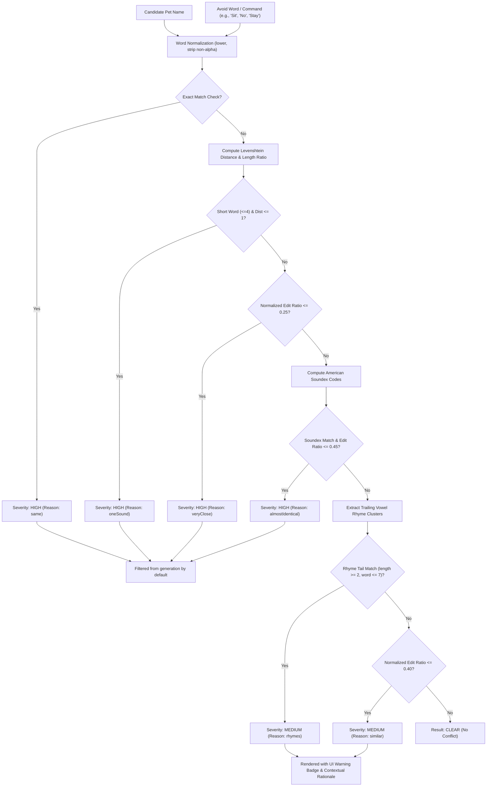
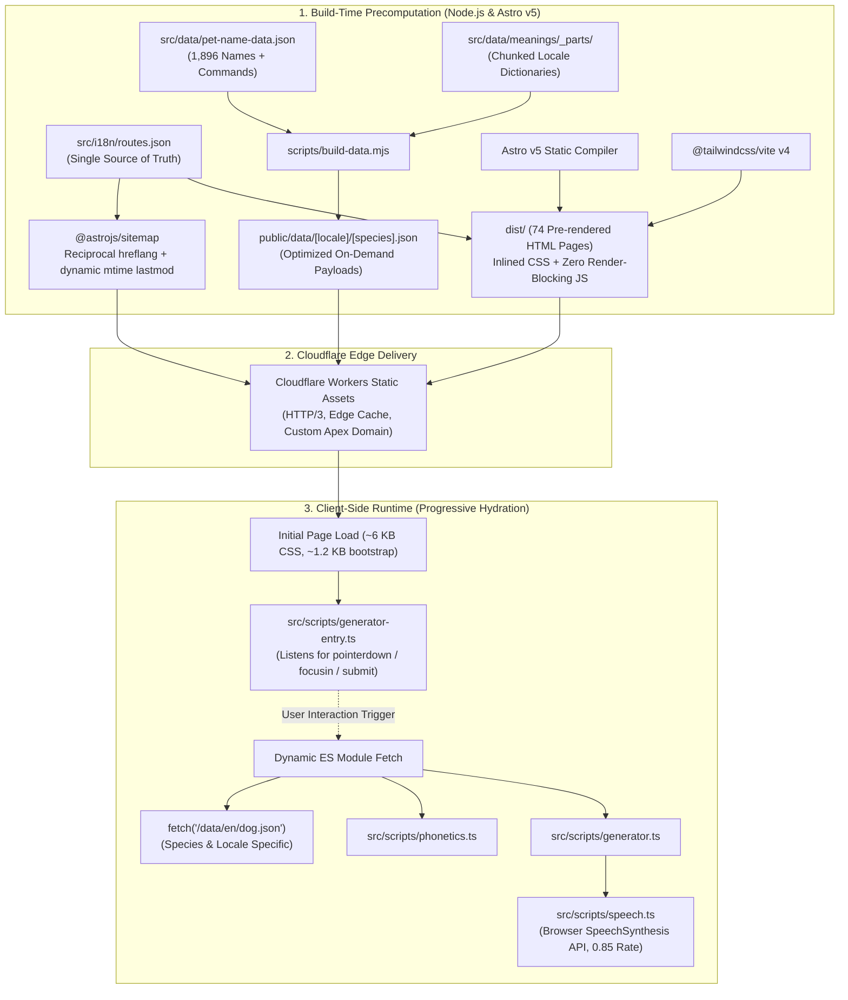

# PerfectPetNameGenerator.com 🐾⚡

> **A high-performance, privacy-first pet name generation platform and phonetic conflict engine built with Astro v5, TypeScript, Tailwind CSS v4, and Cloudflare Workers static edge delivery.**

[](https://perfectpetnamegenerator.com)
[](https://astro.build)
[](https://www.typescriptlang.org)
[](https://tailwindcss.com)
[](https://workers.cloudflare.com)
[-success?style=for-the-badge)](https://perfectpetnamegenerator.com/es/)
[](https://perfectpetnamegenerator.com)
[](https://www.w3.org/WAI/standards-guidelines/wcag/)

---

## 📌 Executive Summary

Most pet name directories on the web suffer from severe UX and technical deficiencies: bloated WordPress templates, invasive advertising networks, multi-second layout shifts, and random lists lacking context. Crucially, they ignore the **cognitive acoustics of animal behavioral training**: names that phonetically clash with core obedience commands (such as naming a dog *"Bo"* when teaching *"No"*, *"Ray"* when teaching *"Stay"*, or *"Kit"* when teaching *"Sit"*) cause behavioral confusion and training regression.

**PerfectPetNameGenerator.com** is an engineered, privacy-first web application designed to solve this problem through algorithmic precision:
1. **Curated Etymological Database**: 1,896 hand-verified pet names (930 dogs, 966 cats) categorized by style, gender, and documented historical/cultural meanings.
2. **Multi-Signal Phonetic Conflict Engine**: Integrates **American Soundex**, **iterative Levenshtein edit distance**, and **vowel cluster rhyme-tail analysis** to eliminate command confusion.
3. **Harmonic Bonded-Pair Generation**: Ensures multi-pet households receive acoustic pairs that do not cross-trigger each other.
4. **Zero-Latency Client-Side Architecture**: Built with Astro v5 Static Site Generation (SSG) and lazy progressive hydration. 100% client-side computation with zero backend API roundtrips, zero user data tracking, and zero cookies.
5. **Global Multi-Locale Programmatic Architecture**: 6 localized languages across 74 fully pre-rendered static routes with automated reciprocal `hreflang` sitemaps, JSON-LD structured schemas, and strict WCAG contrast testing.

---

## ⚡ Performance Scorecard & Core Web Vitals

The application is engineered for maximum performance, minimal bundle size, and instant perceived responsiveness:

| Metric | Target | Production Value | Engineering Mechanism |
| :--- | :--- | :--- | :--- |
| **First Contentful Paint (FCP)** | `< 0.8s` | **`< 0.4s`** | Zero-JS initial document, inlined critical CSS (`inlineStylesheets: 'always'`), self-hosted preloaded WOFF2 fonts. |
| **Largest Contentful Paint (LCP)** | `< 1.2s` | **`< 0.6s`** | Zero render-blocking remote stylesheets; static edge caching via Cloudflare CDN. |
| **Total Blocking Time (TBT)** | `0 ms` | **`0 ms`** | Micro-bootstrap entry (`generator-entry.ts`); controller and phonetic algorithms are lazy-loaded only on user interaction. |
| **Cumulative Layout Shift (CLS)** | `0.00` | **`0.00`** | Deterministic container reservations, CSS aspect ratios, and zero client-side layout restyling. |
| **Initial Critical CSS** | `< 10 KB` | **`~6 KB gzip`** | Modern Tailwind CSS v4 compiler output inlined directly into HTML `<head>`. |
| **Initial JS Payload** | `< 2 KB` | **`~1.2 KB`** | Tiny listener module; full generator runtime deferred until user touches or focuses the form. |

---

## 🔬 Algorithmic Engine & Phonetic Conflict Analysis

Animal behavioral research confirms that canines and felines discriminate auditory cues primarily by **initial consonant burst**, **dominant vowel formants**, and **cadence/terminal rhyme**. A command filter relying on simple string matching or naive Soundex fails because Soundex ignores differences in first letters (`"Bo"` vs `"No"` produce codes `B000` and `N000`).

To solve this, our TypeScript engine ([`phonetics.ts`](src/scripts/phonetics.ts)) implements a **three-tier composite scoring algorithm**:



### 1. American Soundex Integration
Translates homophonic variants and alternative orthographies into phonetic equivalence classes (e.g., `"Kai"` vs `"Chi"`). 

### 2. Iterative Two-Row Levenshtein Edit Distance
Calculates the minimum single-character edits (insertions, deletions, substitutions) between candidate $a$ and target $b$:

$$D(i, j) = \min \begin{cases} D(i-1, j) + 1 \\ D(i, j-1) + 1 \\ D(i-1, j-1) + \mathbb{I}(a_i \neq b_j) \end{cases}$$

- Evaluates edit ratio $\rho = \frac{\text{dist}}{\max(|a|, |b|)}$.
- High-severity thresholds protect monosyllabic commands: if $\max(|a|, |b|) \le 4$ and $\text{dist} \le 1$, the name is flagged as `oneSound` (e.g., `"Bo"` vs `"No"`, `"Kit"` vs `"Sit"`, `"Dawn"` vs `"Down"`).

### 3. Vowel Cluster Rhyme-Tail Extraction
Scans backward to anchor on the *start* of the final vowel cluster to capture diphthongs and syllable codas:
- Accurately captures phonetic matches that Levenshtein and Soundex miss: `"Ray"` vs `"Stay"` (rhyme tail `-ay`), `"Gus"` vs `"Bus"`, `"Sprout"` vs `"Out"`.

### 4. Harmonic Bonded-Pair Generation
When adopting sibling pets (two dogs, two cats, or bonded pairs), calling one pet must not accidentally summon the other. The engine runs $O(N^2)$ candidate clash evaluations through `namesClash(a, b)` to guarantee acoustic diversity across pairs.

---

## 🏗️ System Architecture & Engineering Highlights



### Architectural Highlights

1. **Lazy Progressive Hydration Without Framework Bloat**:
   - Instead of shipping megabytes of React/Vue runtimes, interactive elements use vanilla TypeScript.
   - Initial document ships only `generator-entry.ts` (~1.2 KB), listening to pointer, focus, and submit events.
   - If a visitor submits immediately, the entry script intercepts the event (`pending = true`), dynamically imports the controller, and executes seamlessly without layout shift or dropped clicks.
2. **Edge-Ready Static Splitting**:
   - `scripts/build-data.mjs` splits the monolithic database into discrete per-species and per-locale files (`public/data/[locale]/[species].json`). The client fetches only the exact JSON file required for the user's active configuration.
3. **Zero-Latency Native Speech Synthesis**:
   - Browser pronunciation utilizes the native `window.speechSynthesis` API ([`speech.ts`](src/scripts/speech.ts)), pre-warmed on load and dialed to an acoustic rate of `0.85` (simulating natural vocal pet-calling cadence). Zero audio MP3 downloads or cloud TTS API fees.
4. **Dynamic File-Dependency `lastmod` Generation**:
   - Search engines penalize sites that set blanket `new Date()` timestamps on static builds. Our sitemap generator (`astro.config.mjs`) reads the physical filesystem `statSync().mtime` of the template view, translation file, and data source that composed that specific page.
5. **Color Science & WCAG Contrast Automation**:
   - [`scripts/check-contrast.mjs`](scripts/check-contrast.mjs) mathematically converts sRGB channels to linear RGB to compute real WCAG relative luminance:

$$L = 0.2126 \cdot R_{\text{linear}} + 0.7152 \cdot G_{\text{linear}} + 0.0722 \cdot B_{\text{linear}}$$

$$\text{Contrast Ratio} = \frac{L_1 + 0.05}{L_2 + 0.05}$$

   - Validates all 22 theme color pairings across both Light and Dark modes to guarantee full **WCAG AA/AAA compliance** before code can be built or deployed.

---

## 🌐 Internationalization & Programmatic SEO (pSEO)

The platform is engineered for international reach across 6 primary markets:

| Code | Language | Route Root | Locale Example |
| :---: | :--- | :--- | :--- |
| `en` | **English** (Default) | `/dog-names/` | `/dog-names/`, `/pet-names-to-avoid/` |
| `es` | **Español** | `/es/` | `/es/nombres-de-perros/`, `/es/nombres-de-mascotas-que-evitar/` |
| `fr` | **Français** | `/fr/` | `/fr/noms-de-chiens/`, `/fr/noms-d-animaux-a-eviter/` |
| `de` | **Deutsch** | `/de/` | `/de/hundenamen/`, `/de/haustiernamen-vermeiden/` |
| `pt` | **Português** | `/pt/` | `/pt/nomes-de-cachorro/`, `/pt/nomes-de-pets-a-evitar/` |
| `it` | **Italiano** | `/it/` | `/it/nomi-per-cani/`, `/it/nomi-per-animali-da-evitare/` |

### SEO & Schema Features
- **Strict Reciprocal `hreflang`**: Every route exposes complete alternate link headers for all 6 languages plus `x-default`, mirrored identically inside the XML sitemap.
- **Rich Structured Data (JSON-LD)**: Programmatically injects `WebSite`, `Organization`, `FAQPage`, `Article`, and `BreadcrumbList` schemas on relevant views.
- **Legacy Route Preservation**: Seamless 301 redirect map in `public/_redirects` covering deprecated path variants without link equity loss.

---

## 📁 Repository Structure

```text
perfectpetnamegenerator.com/
├── public/                     # Static edge assets (fonts, favicons, OG images, _redirects)
│   └── fonts/                  # Self-hosted Fraunces variable font (WOFF2)
├── scripts/                    # Production validation & build pipeline tooling
│   ├── audit-build.mjs         # Post-build SEO, hreflang, schema, and a11y validator
│   ├── build-data.mjs          # Data transformation & per-locale JSON splitter
│   ├── build-og.mjs            # OpenGraph social card image generator
│   ├── check-contrast.mjs      # WCAG AA/AAA relative luminance contrast audit
│   ├── check-i18n.mjs          # Translation dictionary parity & length checker
│   └── test-phonetics.mjs      # Algorithmic collision calibration test harness
├── src/
│   ├── components/             # Reusable Astro UI components (Header, Footer, ConsentBanner)
│   ├── data/
│   │   ├── pet-name-data.json  # Curated master name, meaning, and command database
│   │   └── meanings/_parts/    # Localized translation fragments for name meanings
│   ├── i18n/
│   │   ├── routes.json         # Single source of truth for all routes & slugs
│   │   ├── config.ts           # Type-safe routing helpers
│   │   └── ui/                 # Dictionaries (en.ts, es.ts, fr.ts, de.ts, pt.ts, it.ts)
│   ├── layouts/
│   │   └── BaseLayout.astro    # Core layout with preloads, SEO meta, and Consent Mode v2
│   ├── lib/                    # Content helpers & editorial metadata
│   ├── pages/
│   │   ├── [...slug].astro     # Dynamic SSG router generating all 72 localized pages
│   │   ├── 404.astro           # English-only lightweight 404 handler
│   │   └── 500.astro           # Server error fallback handler
│   ├── scripts/                # Client-side TypeScript modules
│   │   ├── generator-entry.ts  # Progressive hydration event bootstrap
│   │   ├── generator.ts        # Generator controller & UI state manager
│   │   ├── phonetics.ts        # Soundex, Levenshtein, and Rhyme conflict engine
│   │   ├── shuffle.ts          # Fisher-Yates array shuffling & sampling
│   │   ├── speech.ts           # Web SpeechSynthesis browser pronunciation
│   │   └── strings.ts          # Localized template string interpolator
│   ├── styles/
│   │   └── global.css          # CSS tokens, theme variables, and Tailwind v4 imports
│   └── views/                  # Page template views (Home, Dog, Cat, Pet, Guide, About, etc.)
├── astro.config.mjs            # Astro configuration, sitemap integration & Vite build targets
├── package.json                # Project dependencies and lifecycle scripts
├── tsconfig.json               # Strict TypeScript configuration
└── wrangler.toml               # Cloudflare Workers static assets deployment spec
```

---

## 🛠️ Verification & Quality Assurance Suite

The repository includes a comprehensive, automated testing and audit suite to prevent regressions in accessibility, SEO, translations, and phonetic logic.

```bash
# Run the complete test & audit battery in sequence
npm run verify
```

### Individual Test Commands

| Command | Lifecycle Stage | What It Verifies |
| :--- | :--- | :--- |
| `npm run i18n` | Pre-build | Compares all 5 localized dictionaries against `en.ts`, verifying placeholder parity (`{count}`, `{name}`) and title/description length limits. |
| `npm run test:phonetics` | Unit Testing | Tests phonetic similarity edge-cases and reports active high/medium conflict counts across the entire 1,896 name catalog. |
| `npm run build` | Build | Generates localized JSON payloads via `scripts/build-data.mjs` and compiles 74 static pages to `dist/`. |
| `npm run contrast` | Post-build | Parses `@palette` CSS tokens, converting sRGB to relative luminance and enforcing $\ge 4.5:1$ text and $\ge 3.0:1$ UI contrast ratios across 22 pairs in both light and dark mode. |
| `npm run audit` | Post-build | Validates every generated HTML page in `dist/`: confirms meta titles, meta descriptions, canonical URLs, reciprocal `hreflang` sets, OpenGraph assets, JSON-LD schemas, and zero broken internal links. |
| `npm run check` | Linting | Executes `astro check` for complete TypeScript type safety across `.astro` and `.ts` files. |

---

## 🚀 Getting Started

### Prerequisites
- **Node.js**: `v20.0.0` or higher
- **npm**: `v10.0.0` or higher

### Local Development Setup

```bash
# 1. Clone the repository
git clone https://github.com/FLOWZORA/perfectpetnamegenerator.com.git
cd perfectpetnamegenerator.com

# 2. Install dependencies
npm install

# 3. Start local development server (generates data split payloads first)
npm run dev
```

Visit `http://localhost:4321` in your browser.

### Production Build & Preview

```bash
# Compile production static distribution to dist/
npm run build

# Preview production build locally
npm run preview
```

### Cloudflare Deployment

The application is deployed using Cloudflare Workers static asset routing:

```bash
# Deploy to Cloudflare Workers
npm run deploy
```

*Note: `wrangler.toml` explicitly configures `workers_dev = false` to enforce routing exclusively through the registered apex domain (`perfectpetnamegenerator.com`).*

---

## 👨‍💻 Engineering Profile & Contact

**Vaibhav Tiwari**  
*Full-Stack Engineer & AI/Web Systems Architect*

- **GitHub**: [@tvaibhav619-web](https://github.com/tvaibhav619-web) / [@FLOWZORA](https://github.com/FLOWZORA)
- **Specializations**: High-Performance Web Architecture, Algorithmic System Design, Astro SSG, TypeScript, Tailwind CSS, Programmatic SEO (pSEO), Internationalization (i18n), and Cloudflare Edge Deployments.

<p align="center">
  <sub>Engineered with focus on web performance, accessibility, mathematical rigor, and thoughtful animal behavioral ergonomics.</sub>
</p>
